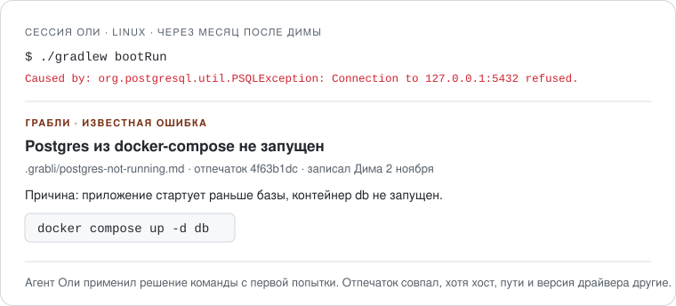

<p align="center"></p>

<h1 align="center">Грабли</h1>

<p align="center">Агент запоминает, как команда чинила ошибки окружения, и второй раз на них не наступает.</p>

Типовые ошибки Claude Code чинит сам. Хуже с тем, что знает только команда: какой контейнер поднять перед запуском, какой сертификат нужен для внутреннего Nexus, почему тесты не видят Docker на Colima. Личная память агента у каждого своя, а CLAUDE.md со списком из сотни известных проблем раздувает контекст каждой сессии.

Грабли ловят упавшие команды в сессии агента и снимают с ошибки отпечаток: без времени, PID, хостов, путей и номеров строк. Если команда уже наступала на эти грабли, агент сразу видит причину и решение из папки `.grabli/` в репозитории. Если не наступала, а команда потом прошла, агент записывает, что помогло. Папка коммитится вместе с кодом, сервер не нужен.

<p align="center"></p>

## Это эксперимент

Неизвестно, часто ли в вашей команде повторяются ошибки, если код пишут агенты. Грабли это считают: сколько было падений, сколько из них уже записано, сколько решений сохранили. Через две недели `статистика граблей` покажет вывод. Если известные грабли попадаются реже раза в неделю, плагин честно скажет, что он вам не нужен.

## Установка

Нужен Claude Code: хукам нужны терминал и папка проекта.

```
/plugin marketplace add shardnessS/grabli
/plugin install grabli@grabli
```

Ещё нужен Python 3.8 или новее. На Windows хуки запускаются через Git Bash, который Claude Code обычно уже использует.

## Пример

Дима запускает проект, `./gradlew bootRun` падает с `Connection to localhost:5432 refused`. Агент поднимает базу, запуск проходит, и хук пишет агенту:

> Grabli: `./gradlew bootRun` failed earlier in this session and now passes (fingerprint 4f63b1dc). If the cause was outside the code being written … record the fix with the grabli skill.

Агент проверяет, что это окружение, а не баг в коде, и пишет `.grabli/postgres-not-running.md`:

```markdown
---
fp: 4f63b1dc
title: Postgres из docker-compose не запущен
author: Дима
---

## Причина
Приложение стартует раньше базы: контейнер `db` из `docker-compose.yml` не запущен.

## Решение
docker compose up -d db
```

Через месяц та же ошибка у Оли на Linux: хост `127.0.0.1`, путь `/home/olya/…`, другая версия драйвера и номера строк. Отпечаток тот же, `4f63b1dc`, и агент Оли получает запись Димы сразу после падения, как на картинке выше.

Полный прогон с выводом каждого шага — [examples/protocol.md](examples/protocol.md).

## Что внутри

| Часть | Что делает |
|---|---|
| Хук на падение | Снимает отпечаток упавшей команды, ищет запись в `.grabli/` и передаёт её агенту. Похожие записи предлагает отдельно |
| Хук на успех | Если команда упала и потом прошла, а записи нет, просит агента записать решение |
| Скилл `grabli` | Когда записывать и когда нет, формат записи, применение известных решений, поиск и статистика |
| `grabli.py` | Отпечатки, поиск, проверка записей и счётчики. Только стандартный Python, без сети |

## Как пользоваться

Обычно никак: хуки работают сами. Руками:

- «Запиши грабли» — сохранить то, что только что починили
- «Это уже чинили?» с текстом ошибки — найти запись
- «Найди в граблях Nexus» — поиск по словам
- «Проверь грабли» — проверка всех записей: поля, дубли, секреты
- «Статистика граблей» — счётчики эксперимента и вывод

## Отпечаток ошибки

Из вывода упавшей команды берутся строки, по которым узнаётся ошибка: описание `APPLICATION FAILED TO START` из Spring Boot, исключения и `Caused by`, блок `What went wrong` из Gradle, `[ERROR]` из Maven. Всё, что меняется от запуска к запуску, заменяется:

| В логе | В отпечатке |
|---|---|
| `2026-09-12T10:14:03.512+03:00`, `PID 48213`, `in 6s` | `<time>`, `PID <n>`, `<dur>` |
| `localhost`, `127.0.0.1` | `<host>` |
| `/Users/dima/work/shop/app.log`, `C:\Users\olya\app.log` | `<path>/app.log` |
| `ConnectionFactoryImpl.java:346` | `ConnectionFactoryImpl.java:<n>` |
| `postgresql-42.7.4.jar`, `1.4.0-SNAPSHOT` | `postgresql-<ver>.jar`, `<ver>` |

Порт `5432` остаётся: он говорит, какого сервиса не хватает. Отпечаток — первые 8 символов SHA-256 от результата. На тестовых логах склеиваются одни и те же ошибки с разных машин: Postgres, Testcontainers без Docker, PKIX у Maven, Flyway, `Cannot find module` в Node, `ModuleNotFoundError` в pytest. Разные ошибки не путаются.

## Когда агент просит записать

Только если команда упала, потом прошла в той же сессии, а записи с таким отпечатком ещё нет. Ошибки компиляции и упавшие проверки в тестах считаются ошибками в коде, о них хук не напоминает. Не больше трёх напоминаний за сессию.

Скилл записывает только то, что лежит вне кода: локальные сервисы, версии инструментов, конфиги, сертификаты и прокси, доступ к реестрам, шаги настройки проекта. Баг в логике приложения агент записывать откажется.

## Записи в репозитории

Одна причина — один файл в `.grabli/`. В шапке отпечаток и заголовок, дальше разделы «Сигнатура», «Причина», «Решение», «Проверка». Формат — [skills/grabli/references/entry-format.md](skills/grabli/references/entry-format.md).

Перед тем как сообщить о записи, агент запускает проверку. Она ловит пропущенные поля и разделы, один отпечаток в двух файлах и строки, похожие на секреты: токены GitHub и GitLab, ключи AWS, JWT, пароли в URL и `password=…`. Заглушки вроде `<token>` и `$DB_PASSWORD` проходят.

## Статистика эксперимента

Хуки ведут журнал в `~/.grabli/` на машине разработчика, в репозиторий он не попадает.

```
Грабли · проект shop-api · с 2026-11-02 по 2026-11-16 (15 дн.)

Падений команд                 37
  известные грабли              5  14%
  похожие записи                2  5%
  ошибки в коде                14  38%
Починились                     26
  по известной записи           4
  напоминаний записать          7
Записей в .grabli/              6

Вывод: Известные грабли срабатывают 2.3 раза в неделю. Повторы есть, идея работает.
```

Цифры в этом блоке для примера. Настоящий вывод в начале эксперимента — в [протоколе прогона](examples/protocol.md).

## Чего Грабли не делают

- Не работают в claude.ai, Cursor и других агентах: нужны хуки Claude Code. Скилл без хуков умеет искать и записывать только по просьбе.
- Не чинят ошибку сами. Решение предлагает запись, выполняет его агент по обычным правилам разрешений.
- Не отправляют ничего в сеть. Записи живут в git, журнал — на машине разработчика.
- Не видят ошибки, которые человек ловит в своём терминале без агента.
- Не заменяют README с инструкцией по запуску проекта. Если одни и те же грабли срабатывают каждую неделю, причину стоит устранить в самом проекте.

## Файлы

```
hooks/
  hooks.json                    хуки PostToolUseFailure и PostToolUse для Bash и PowerShell
  run.sh                        находит Python 3.8+ и запускает скрипт; без Python молча выходит
skills/grabli/
  SKILL.md                      когда записывать, как применять, поиск и статистика
  scripts/grabli.py             отпечатки, хуки, поиск, проверка, статистика
  references/entry-format.md    формат записи и правила отпечатка
  templates/entry.md            шаблон записи
examples/                       протокол ручного прогона и пример записи
evals/                          тест-кейсы для claude plugin eval
tests/                          тесты скрипта и логи ошибок для них
assets/                         иконка и картинка результата
```

## Проверка

Скрипт покрыт тестами на 18 логах ошибок: одни и те же ошибки с разных машин, разные ошибки, ошибки в коде, весь путь хуков от падения до статистики.

```
python -m unittest discover -s tests -v
```

В `evals/` четыре кейса для `claude plugin eval`: запись решения по отпечатку, поиск ошибки, которой нет, отказ записывать баг в коде и статистика без данных. Главный сценарий прогнан вручную, протокол — в [examples/protocol.md](examples/protocol.md).

## Автор

[shardness](https://github.com/shardnessS) · Лицензия MIT
